# Design of LLM-Based Learning Content Generation and Development of Language Learning Service Features

Developed features for a browser extension for a language learning service (LingQ) and a web learning platform (LanguageMaster). Responsible for designing the client, LLM prompts, and API requirements (excluding server/backend).

## 1. LLM-Based Learning Path Design

Designed a Duolingo-style learning path (Section > Unit > Lesson) in which an LLM generates the curriculum and problems from the user's native language, target language, and current level.

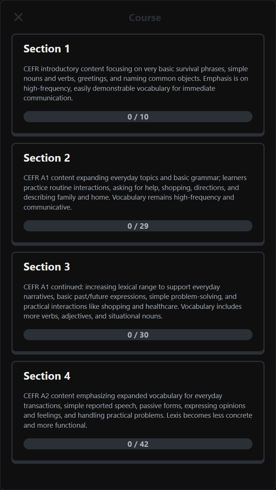
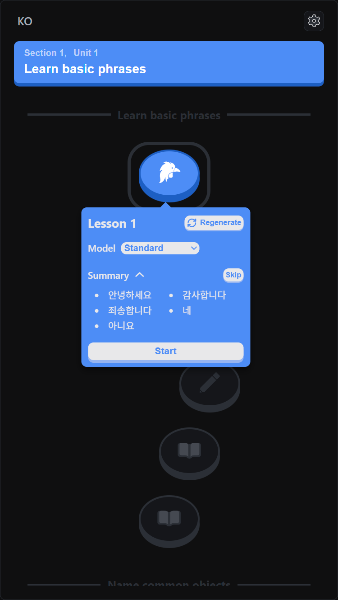
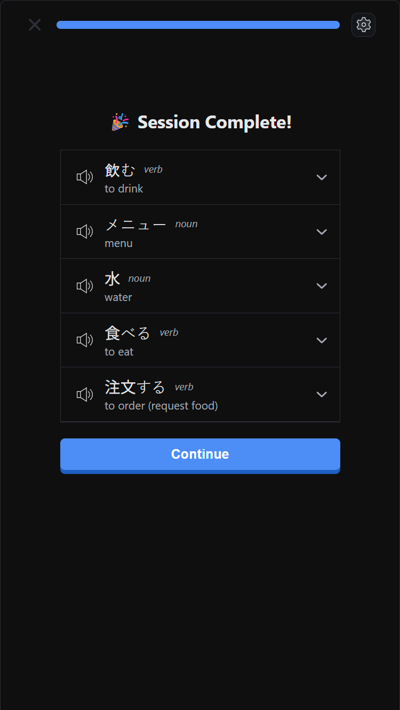

### Curriculum Generation

- Output: Sections 1–4, 10–40 units per section, 20 base-form words (lemmas) per unit. Assigned a CEFR level to each section so vocabulary difficulty rises step by step.
- Constraints: base forms only, balanced parts of speech, no duplicate words across units.
- Implemented and compared two generation approaches: single-pass (one-step) and section-by-section (two-step).

| Approach                                       | Pros                                 | Cons                                                                                                    |
|------------------------------------------------|--------------------------------------|---------------------------------------------------------------------------------------------------------|
| Single-pass (structure + vocabulary together)  | One call, consistent results         | Longer time to first response                                                                           |
| Section-by-section (structure → per-section vocabulary) | Shorter time to first response | Needs earlier results to avoid duplicates across sections; sections cannot be generated concurrently |

Adopted the single-pass approach. Pre-generated the word list for each unit at the curriculum stage to prevent word duplication across lessons.

### Problem Generation

- Designed problem generation so the LLM produces example sentences, distractors, and translations from the lesson vocabulary and unit theme.
  - Built 7 base problem types from a single dataset: meaning → word, word → meaning, confusable-pair matching, sentence translation, fill in the blank, word ordering, and pair matching.
- Designed prompts to produce plausible distractors that require the target knowledge while leaving exactly one correct answer.
- Designed the unit structure, composed of learning lessons and review lessons.

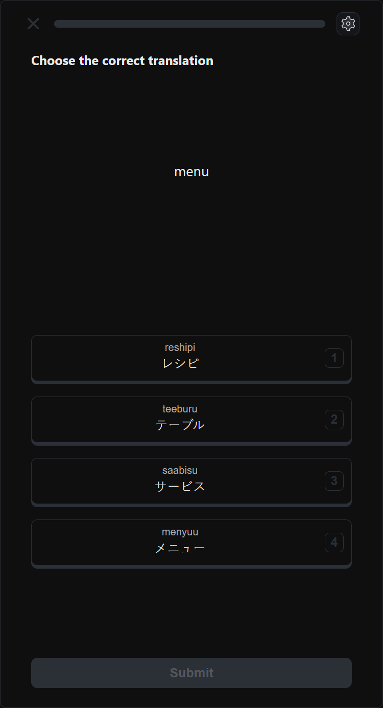
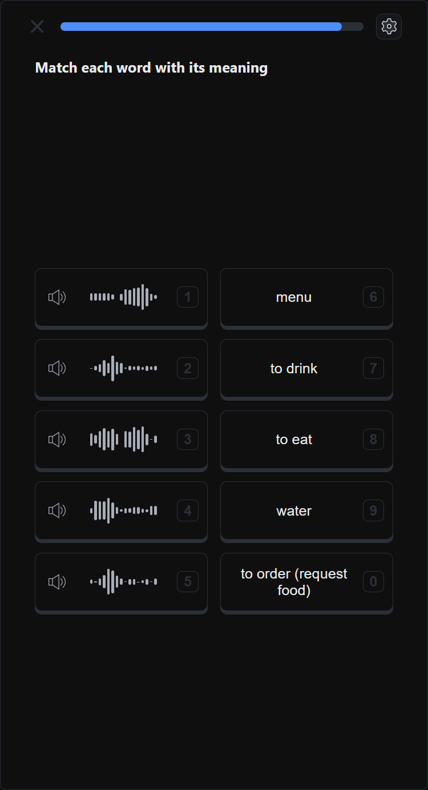
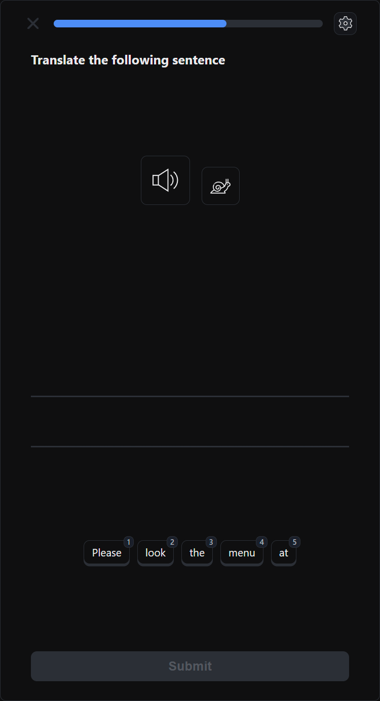
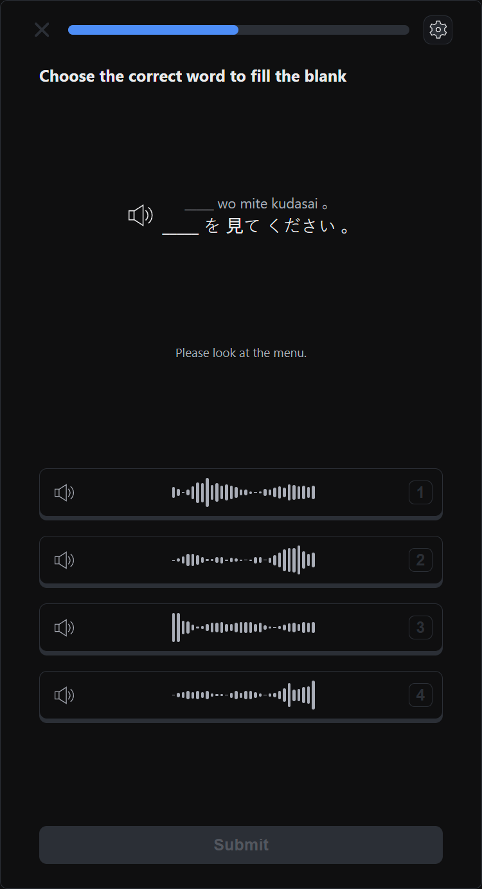

- Implemented settings for problem type selection, translation display, transliteration, and TTS voice selection, along with a mobile-responsive layout.

### API and Asynchronous Job Handling

- Defined requirements for an input-hash-based lookup API: the same input returns the stored result. Integrated generation as an asynchronous job with a status-check (polling) API.
- Designed the polling interval around the response-time distribution of the asynchronous LLM jobs, replacing a fixed interval.

---

## 2. Content Import Browser Extension

A Chrome extension that normalizes content from 8 sources, including YouTube, podcasts, and audiobooks, into learning text and imports it as lessons in the language learning service (LingQ). Rewrote the existing Firefox extension for Chrome Manifest V3.

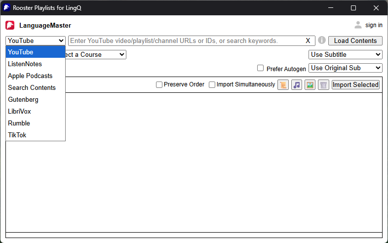

- Unified user-provided, auto-generated, and translated subtitles into a common data format.
- Used an LLM to restore sentence boundaries in auto-generated subtitles that lack punctuation, minimizing false positives so the original words and timestamps stay unchanged.
- Built prompts dynamically from a per-language map of sentence-ending punctuation. Skipped the LLM call for subtitles that already have punctuation.
- Modularized 7 STT providers behind a single interface. Compared their quality on the same Korean audio and provided a selection UI to choose by cost and quality.

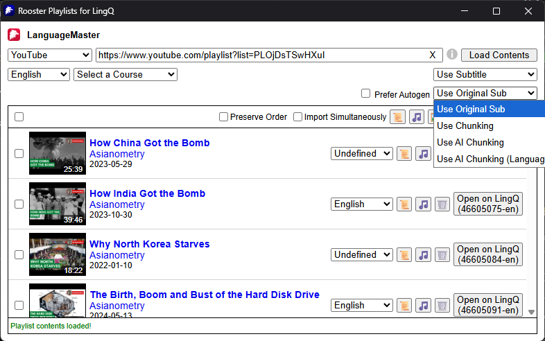
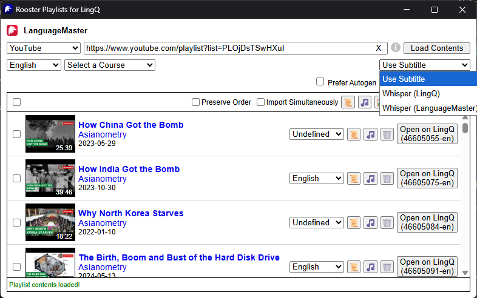

---

## 3. Learning Data Features (Web)

- SRS: Designed Anki-style scheduling. Computed the next review time from the user's response (Again / Hard / Good / Easy) and served due words and new words mixed at a set ratio.
- Practice: Generated practice problems of several types from a lesson's unknown words.
- Stats: Implemented a dashboard with a streak calendar, yearly heatmap, today's study volume, and period charts (daily + cumulative). Supported mobile-responsive layouts.
- Vocabulary: Revamped the word list UI (status 0–5, filters), with AI word generation and bulk import.

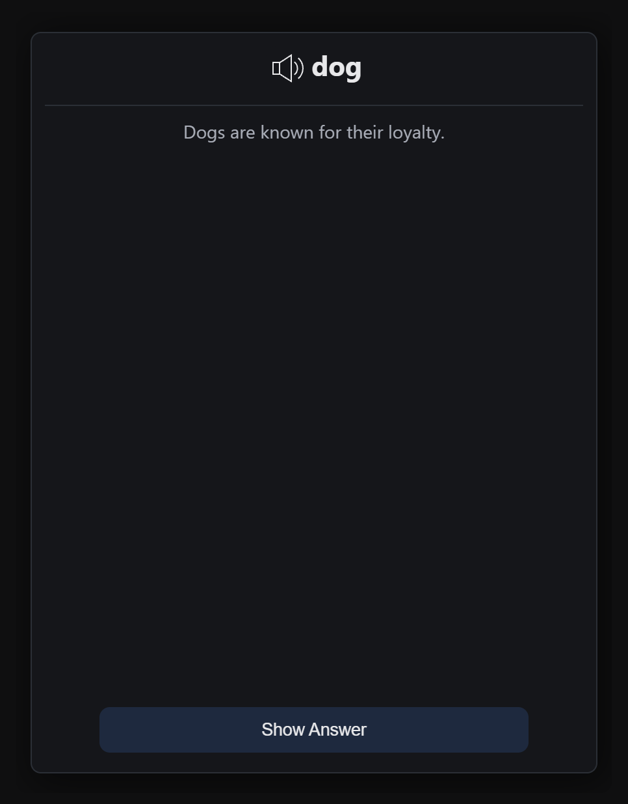
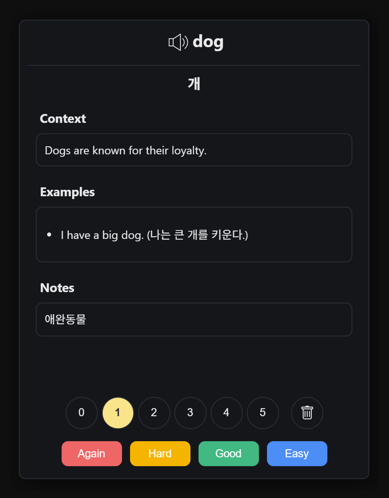

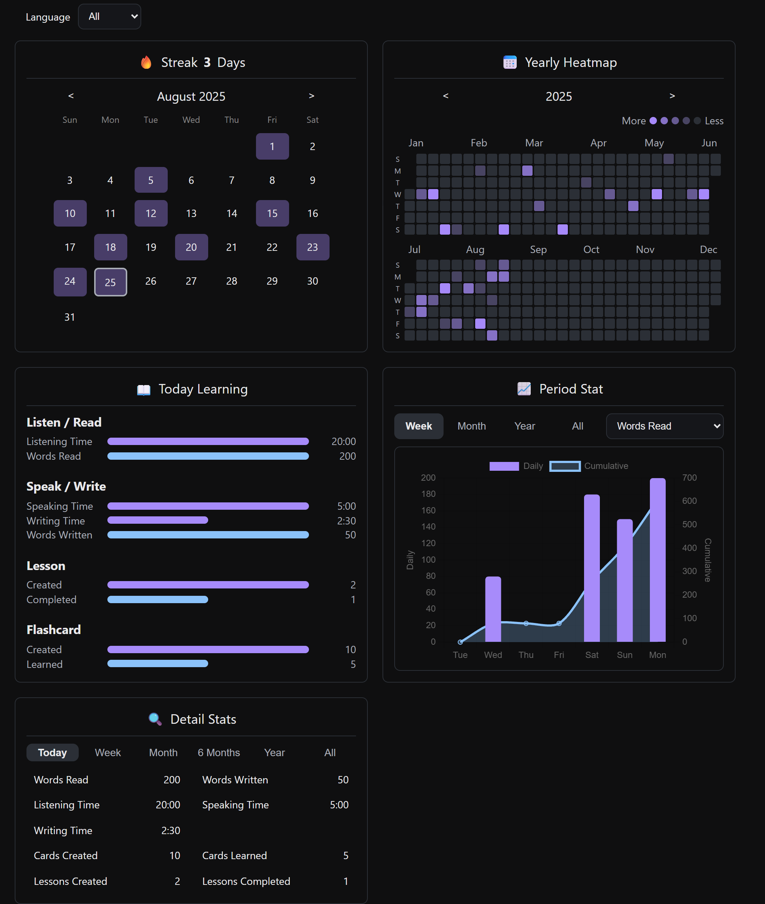

---

## 4. Supporting Tools for the Learning Service

- Lesson Importer: Structured local text, subtitle, and audio files/folders into a list and bulk-uploaded them as courses in the learning service. Included automatic course creation from folder names and options for audio transcription and sentence splitting.

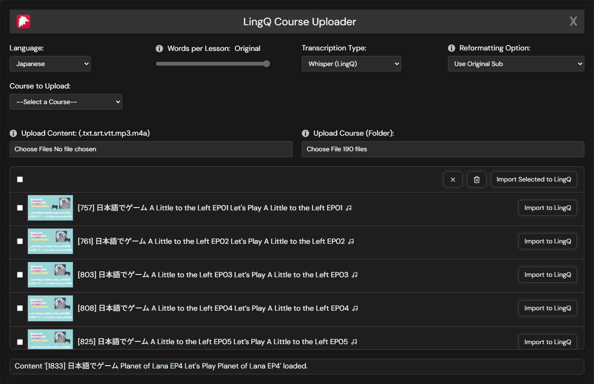

- Navigator: Built a navigation menu for courses, lessons, and playlists, with sorting, search, and per-item learning status.

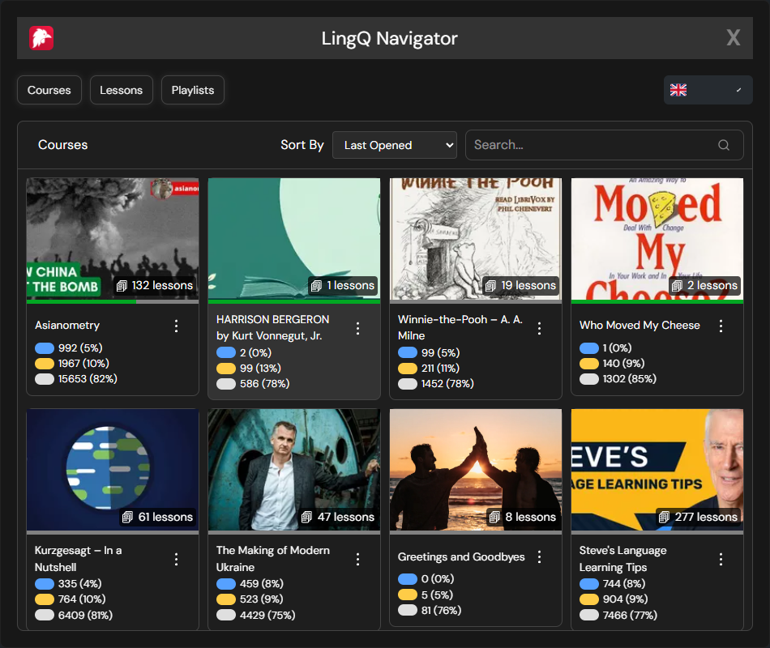
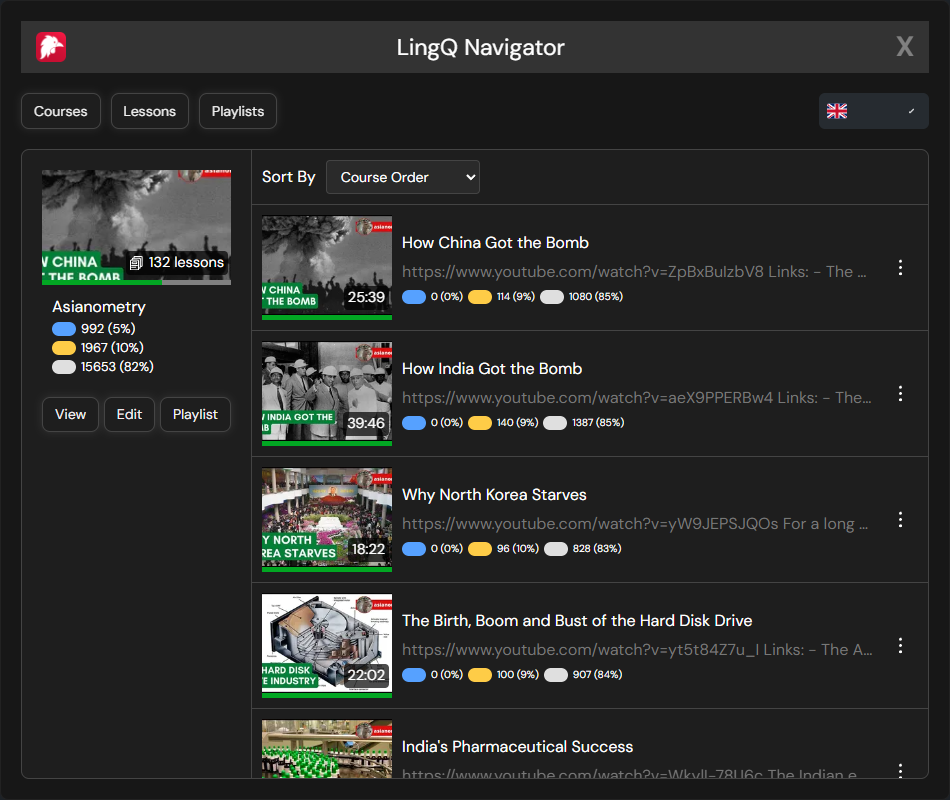
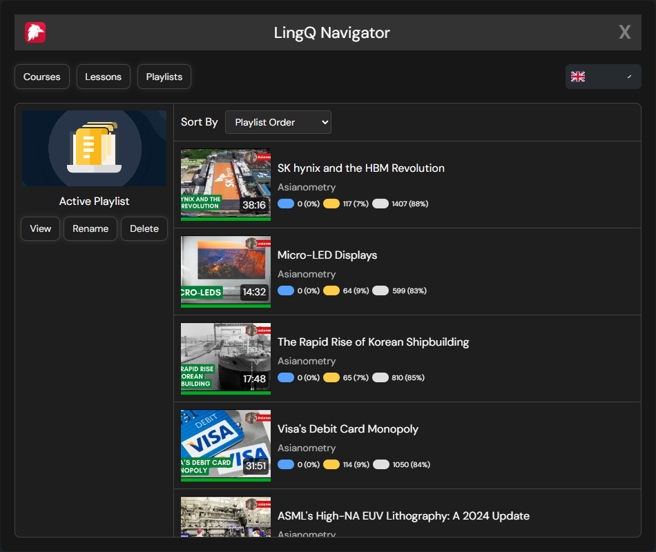

