# LLM 기반 학습 콘텐츠 생성 설계와 언어 학습 서비스 기능 개발

언어 학습 서비스(LingQ)용 브라우저 확장 프로그램과 웹 학습 플랫폼(LanguageMaster)의 기능 개발. 클라이언트, LLM 프롬프트, API 요구사항 설계 담당 (서버/백엔드 제외).

## 1. LLM 기반 학습 경로 설계

사용자 모국어, 학습 언어, 현재 수준을 토대로 LLM이 커리큘럼과 문제를 생성하는 Duolingo 스타일 학습 커리큘럼(Section > Unit > Lesson) 설계.

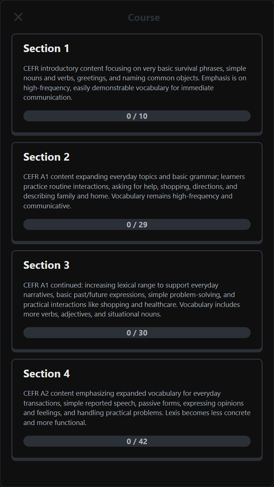
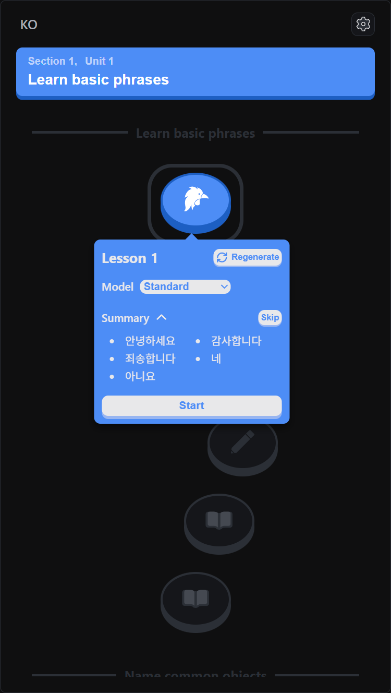
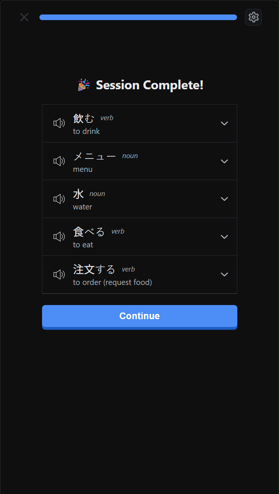

### 커리큘럼 생성

- 출력: Section 1~4, 섹션별 Unit(10~40개), Unit별 표제어 20개. 섹션마다 CEFR 수준을 지정해 어휘 난이도를 단계적으로 상승.
- 제약: 표제어만 사용, 품사 균형 유지, Unit 간 단어 중복 금지.
- 생성 방식 두 가지, 한 번에 생성(one-step)과 단계별 생성(two-step)을 구현해 비교.

| 방식                        | 장점               | 단점                                            |
|---------------------------|------------------|-----------------------------------------------|
| 한 번에 생성 (구조 + 어휘 동시)     | 단일 호출, 일관성 있는 결과 | 최초 응답시간 증가                                  |
| 단계별 생성 (구조 → 섹션별 어휘)    | 짧은 최초 응답시간       | 이전 섹션 단어 중복 방지를 위해 이전 생성 결과 참조 필요, 섹션 동시 생성 불가 |

한 번에 생성 방식 채택. 커리큘럼 단계에서 Unit별 단어 목록을 미리 생성해 레슨 간 단어 중복 방지.

### 문제 생성

- LLM이 레슨 어휘, 주제를 기반으로 예문, 오답 선택지, 번역을 포함한 학습 데이터 생성.
  - 하나의 데이터셋으로 7개 기본 유형 구성: 뜻 → 단어, 단어 → 뜻, 혼동 쌍 매칭, 문장 번역, 빈칸 채우기, 단어 순서 배열, 쌍 매칭.
- 중복 정답이 생기지 않으면서 변별력 있는 오답 후보를 제시하도록 프롬프트 설계.
- 학습 레슨과 복습 레슨으로 구성된 Unit 구조 설계.

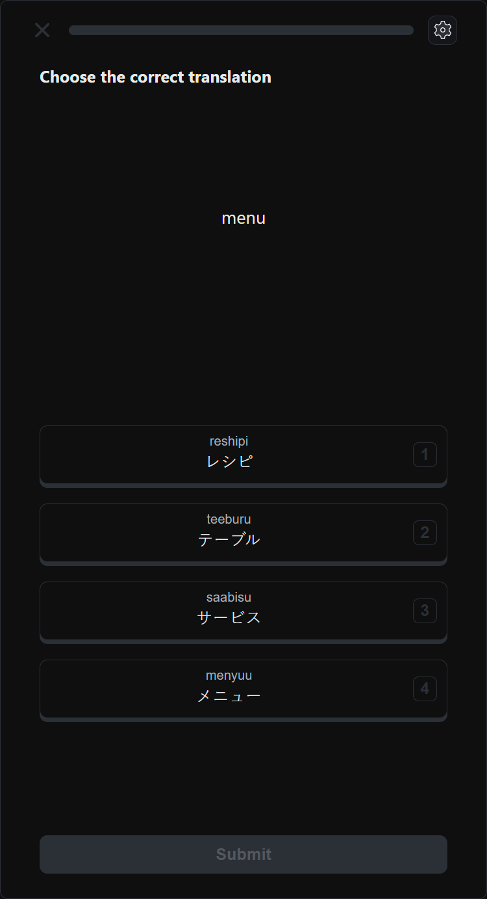
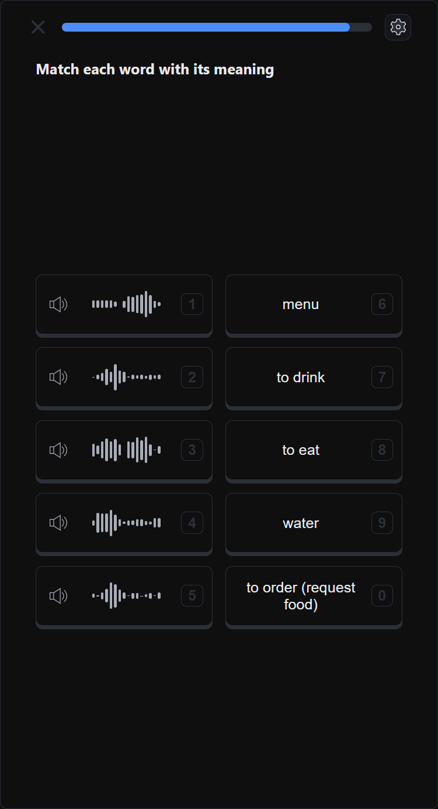
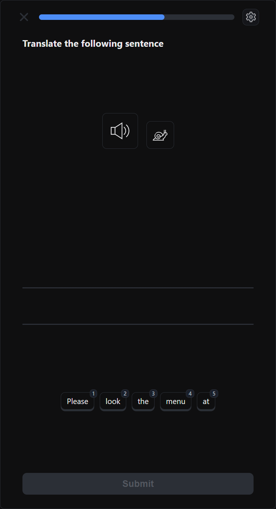
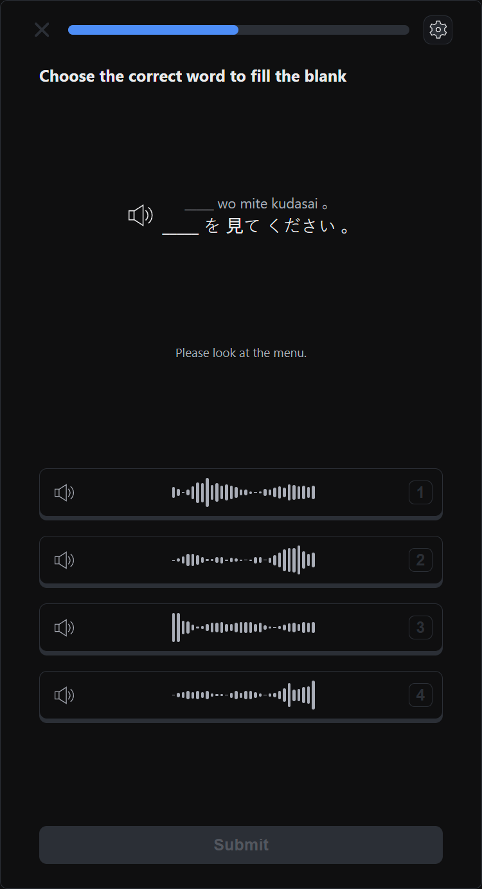

- 문제 유형 선택, 번역 표시, 음역, TTS 음성 선택 설정, 모바일 반응형 레이아웃 구현.

### API와 비동기 작업 처리

- 입력 해시 기반 조회 API 요구사항 정의: 같은 입력이면 저장된 결과 반환. 생성은 비동기 작업 + 상태 조회 API 연동.
- 상태 조회(폴링) 간격은 비동기 LLM 작업의 응답 시간 분포에 맞춰 설계해 기존 고정 간격을 대체.

---

## 2. 콘텐츠 import 브라우저 확장

YouTube, 팟캐스트, 오디오북 등 8개 소스의 콘텐츠를 학습용 텍스트로 정형화해 언어 학습 서비스(LingQ)의 레슨으로 가져오는 Chrome 확장 프로그램. 기존 Firefox 확장을 Chrome Manifest V3 구조로 재작성.

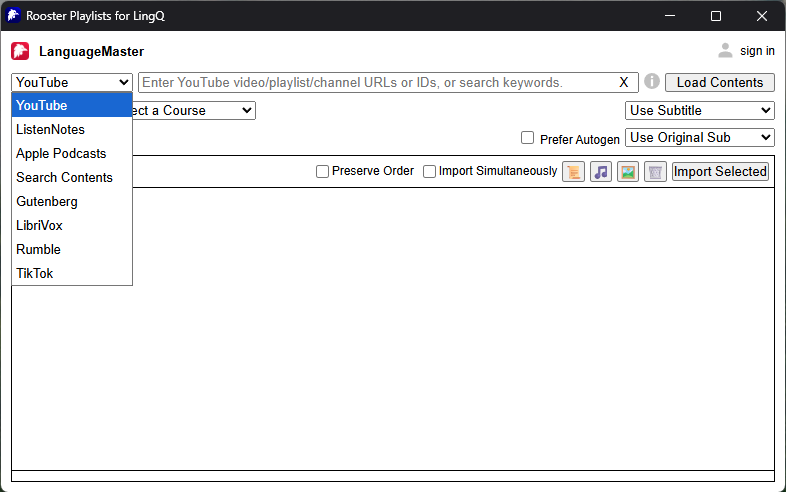

- 사용자 제공, 자동 생성, 번역 자막을 같은 형식의 객체로 통일.
- 구두점이 없는 자동 생성 자막의 문장 경계를 LLM으로 복원. 원문 단어와 타임스탬프가 바뀌지 않도록 오탐을 최소화하는 방식으로 구현.
- 언어별 문장 종결 부호 맵으로 프롬프트를 동적으로 구성. 이미 구두점이 있는 자막은 LLM 호출 생략.
- STT 제공자 7개를 하나의 인터페이스로 모듈화. 같은 한국어 음성으로 품질을 비교하고, 비용과 품질에 따라 고르는 선택 UI 제공.

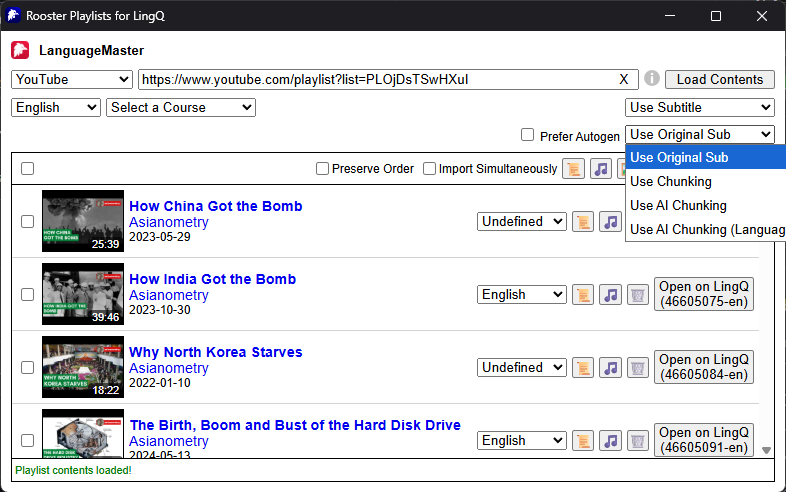
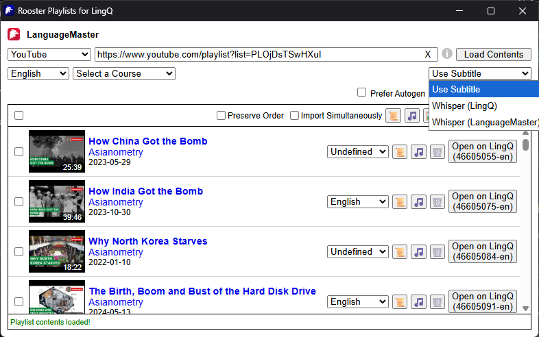

---

## 3. 학습 데이터 기능 (웹)

- SRS: Anki 스타일 스케줄링 설계. 사용자 응답(Again / Hard / Good / Easy)에 따라 다음 복습 시점을 계산하고, 복습 대상과 신규 단어를 지정한 비율로 혼합 출제.
- Practice: 레슨 내의 모르는 단어를 사용해 여러 유형의 문제 출제.
- Stats: 스트릭 달력, 연간 히트맵, 오늘의 학습량, 기간별 차트(일별 + 누적) 대시보드 구현. 모바일 반응형 대응.
- Vocabulary: 단어장 UI 개편(상태 0~5, 필터), AI 단어 생성과 일괄 import.

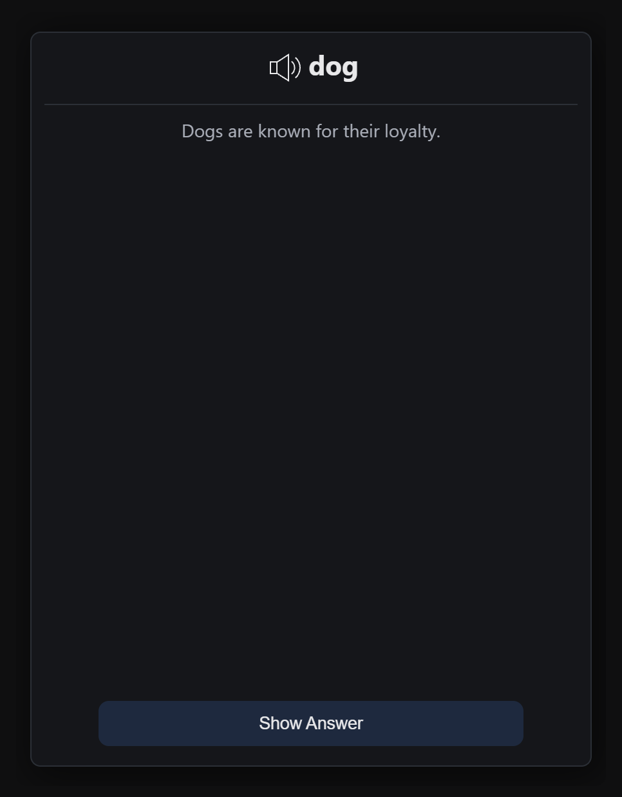
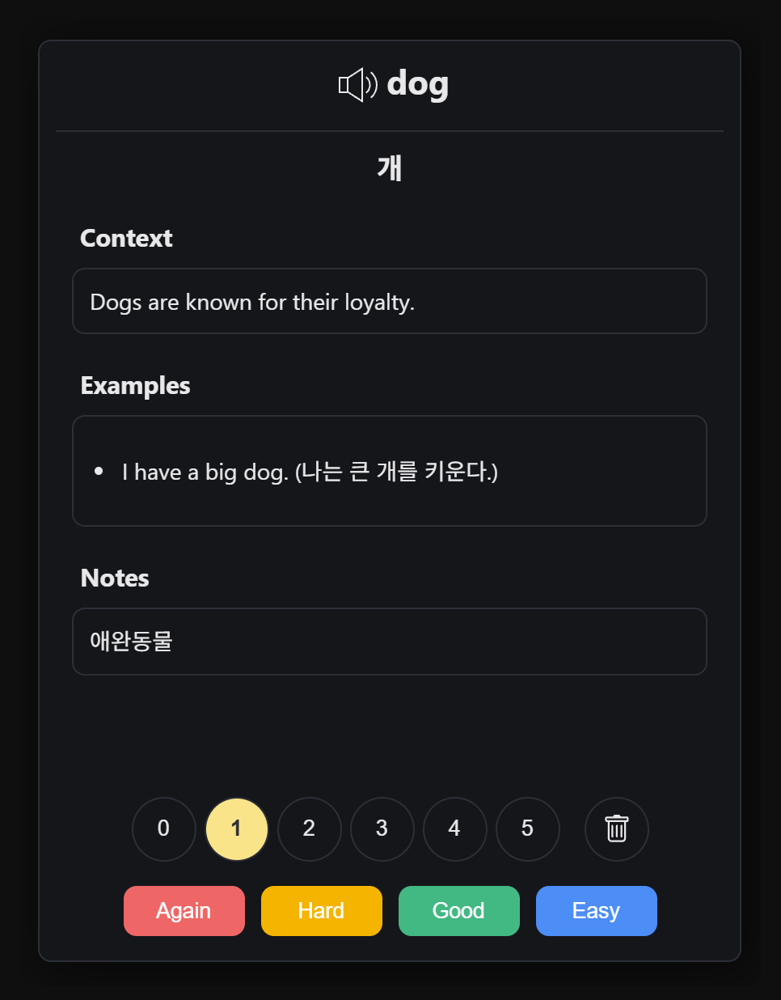

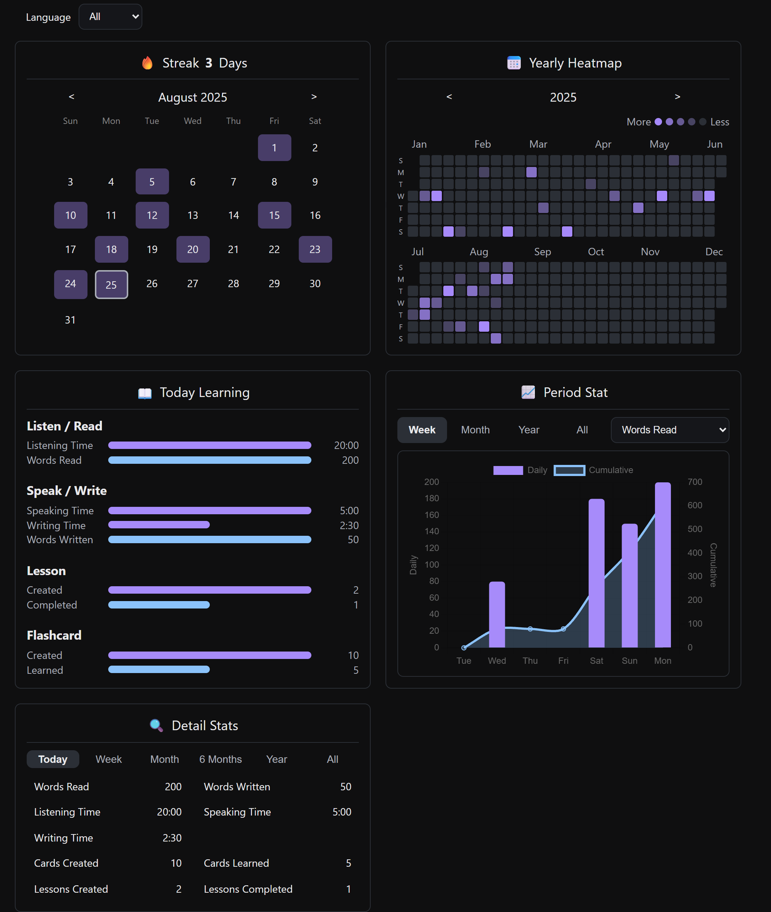

---

## 4. 학습 서비스 보조 도구

- Lesson Importer: 로컬 텍스트, 자막, 오디오 파일/폴더를 목록으로 구조화해 학습 서비스 코스로 일괄 업로드. 폴더명 기반 코스 자동 생성, 오디오 전사와 문장 분할 옵션.

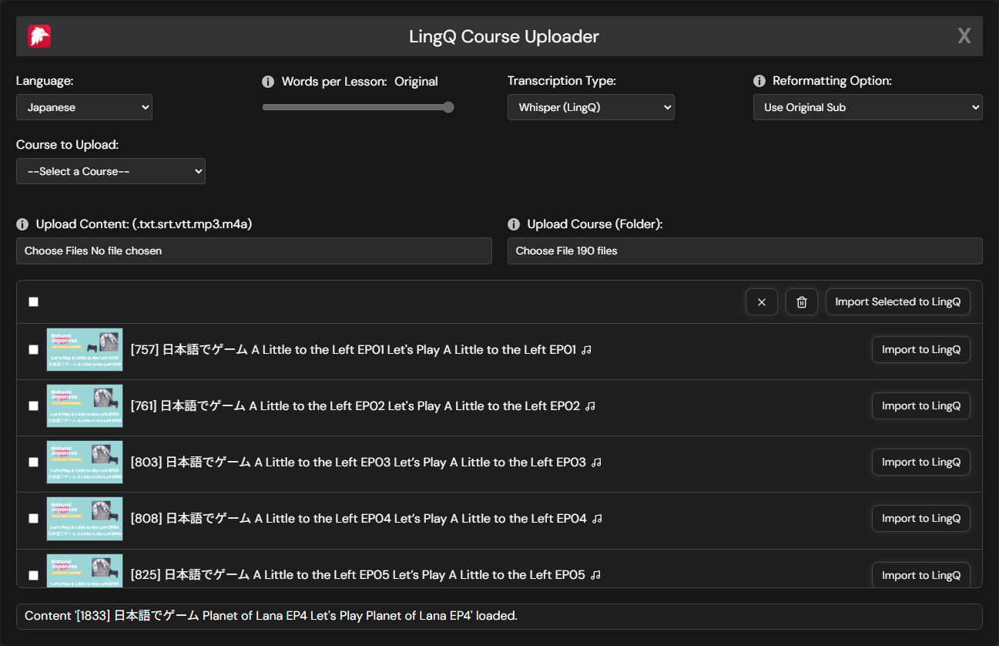

- Navigator: 코스, 레슨, 플레이리스트 탐색 메뉴. 정렬, 검색, 항목별 학습 상태 표시.

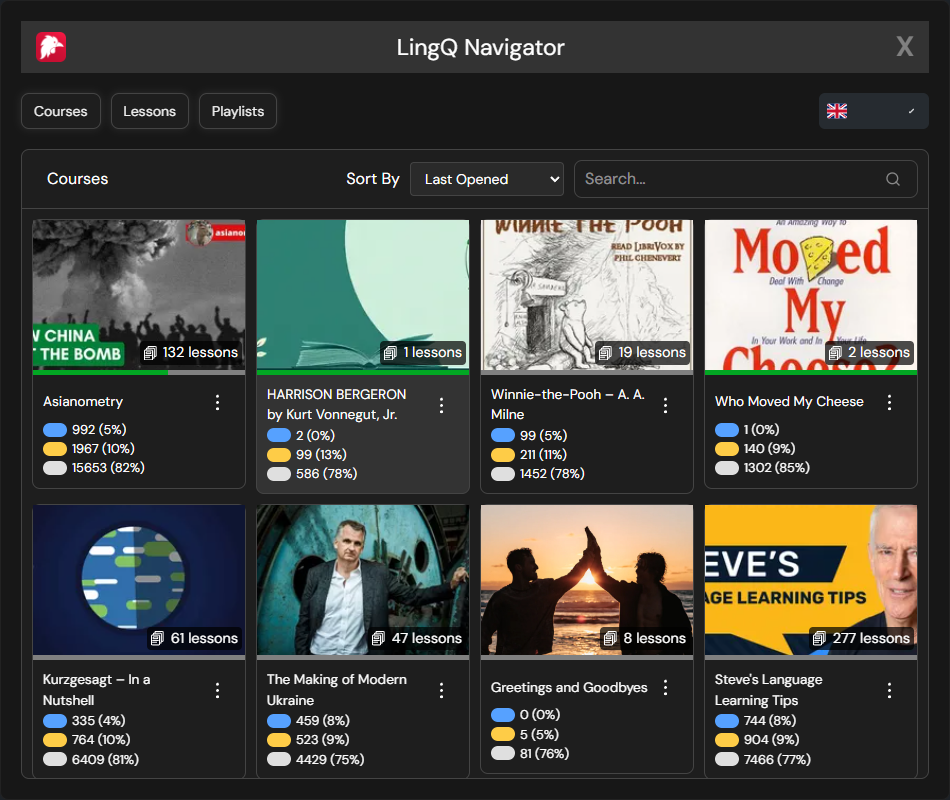
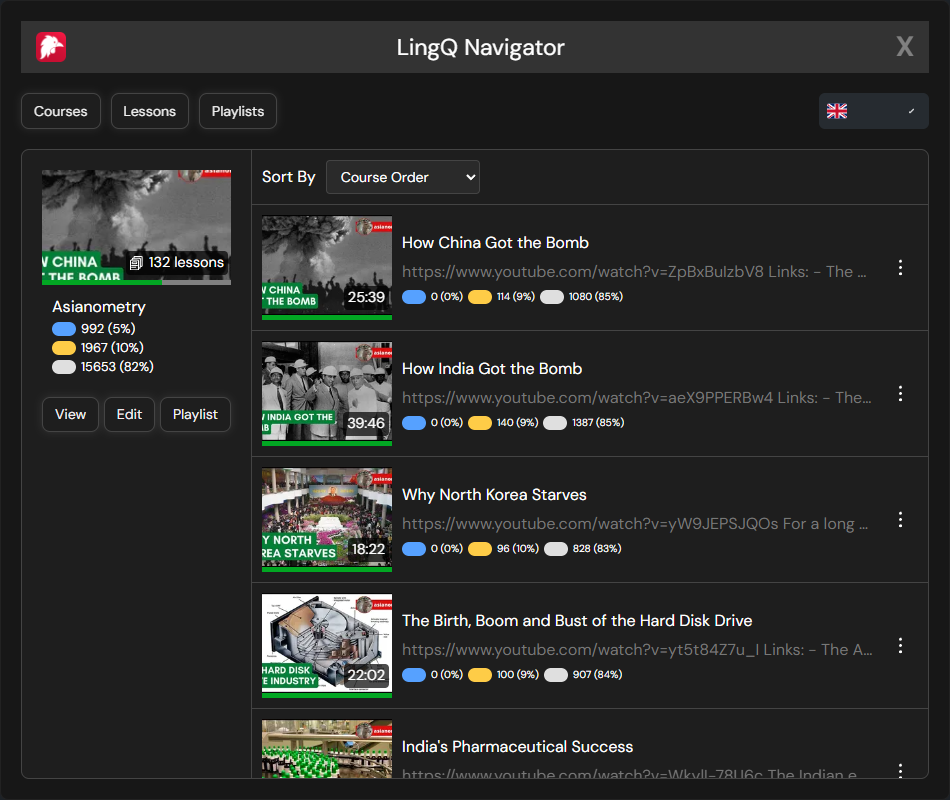
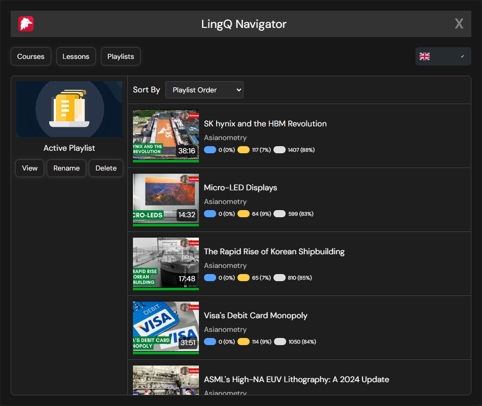

